<p align="right"><b>English</b> · <a href="README.tr.md">Türkçe</a></p>

<p align="center">
  
</p>

<h1 align="center">Mode_Code</h1>

<p align="center">
  <b>A local companion for Claude Code.</b><br>
  A safety belt, modes and a quota guard inside Claude Code, and a control center in your terminal.<br>
  Everything stays on your machines. No telemetry.
</p>

<p align="center">
  <a href="https://github.com/OzcanOrhanDemirci/Mode_Code/actions/workflows/ci.yml"></a>
  <a href="https://github.com/OzcanOrhanDemirci/Mode_Code/releases/latest"></a>
  <a href="LICENSE"></a>
  
</p>

<p align="center">
  
</p>

## Install

> [!TIP]
> **Copy one line into your terminal and press Enter.** The installer brings everything Mode_Code needs, Node.js included when you have none, and changes nothing in Claude Code until you say yes.

**macOS and Linux**

```sh
curl -fsSL https://raw.githubusercontent.com/OzcanOrhanDemirci/Mode_Code/main/install.sh | sh
```

**Windows** (PowerShell)

```powershell
irm https://raw.githubusercontent.com/OzcanOrhanDemirci/Mode_Code/main/install.ps1 | iex
```

Then start a new Claude Code session (`claude`). The strip above the prompt shows the mode and the way of working: Mode_Code is on. Type `/0` there for the control center.

- **Update:** `mode-code update` (or `u` under Maintenance in the control center) runs the newest release's own installer, checked against its checksums; running the same line again does the same. If you said yes at install, Mode_Code checks once a day whether a newer release is out and says so in the doctor, the `/0` menu and the morning report.
- **Remove:** `mode-code uninstall`. It takes out exactly what was installed, the program and its command included; add `--purge` to delete your settings and history too.

<details>
<summary><b>What the installer does</b>, its options, and other ways to install</summary>

<br>

1. **Node.js.** It uses Node.js 22.13 or newer from your PATH. Without one, it downloads the official Node.js 24 build from nodejs.org, checks it against nodejs.org's SHA-256 list and keeps it for Mode_Code alone: no administrator rights, no sudo, nothing installed system-wide.
2. **The package.** It downloads the newest [release](https://github.com/OzcanOrhanDemirci/Mode_Code/releases) and checks it against the release's `SHA256SUMS`. A download that does not match is never installed.
3. **The program.** It goes to `~/.local/share/mode-code` (Windows: `%LOCALAPPDATA%\mode-code`), and the `mode-code` command to `~/.local/bin` (Windows: `%USERPROFILE%\.local\bin`). When that folder is not on your PATH yet, it is added: one marked line in your shell's startup file, or your user PATH on Windows.
4. **Claude Code.** It runs `mode-code install`, which shows every change it will make to Claude Code, asks once, backs up your settings and tests itself. Without Claude Code it offers to run [Anthropic's official installer](https://code.claude.com/docs/en/setup) first.

Read them before you run them: [install.sh](install.sh) · [install.ps1](install.ps1).

| To                                     | macOS and Linux                              | Windows                                                |
| -------------------------------------- | -------------------------------------------- | ------------------------------------------------------ |
| pass options                           | `curl -fsSL <address> \| sh -s -- <options>` | `& ([scriptblock]::Create((irm <address>))) <options>` |
| answer yes to every question (scripts) | `--yes`                                      | `-Yes`                                                 |
| install a given version                | `--version 1.1.0`                            | `-Version 1.1.0`                                       |
| leave PATH alone                       | `--no-modify-path`                           | `-NoModifyPath`                                        |
| install the program only               | `--no-setup`                                 | `-NoSetup`                                             |

**Try it first.** Install with `--no-setup` (Windows: `-NoSetup`), then run `mode-code try`: it starts one Claude Code session with everything loaded and changes nothing in your Claude Code configuration.

**From source** (Node.js 22.13 or newer):

```sh
git clone https://github.com/OzcanOrhanDemirci/Mode_Code.git
cd Mode_Code && npm ci && npm run build
node dist/cli.mjs install
```

</details>

## First steps

| Do this                                                        | And see                                                                           |
| -------------------------------------------------------------- | --------------------------------------------------------------------------------- |
| `mode-code belt test --command "git push --force origin main"` | what the safety belt would do with a command, without running anything            |
| Type `/3` in Claude Code, then `/4`                            | the mode switch to 📐 plan (nothing outside the plan can change), then to 🔨 code |
| End a message with `myproject continue quota 40`               | Claude picks the project up where it stopped, within 40% of your weekly quota     |
| Type `/0`, or run `mode-code`                                  | the control center: `/0` opens it in a new tab beside the session                 |
| `mode-code doctor`                                             | every feature's health, and how to fix what is not working                        |

Name your projects under Settings › Projects and keywords; everything else works without setting anything up.

## Contents

- [What it does](#what-it-does)
- [Why](#why)
- [Requirements](#requirements)
- [The control center](#the-control-center)
- [Keywords](#keywords)
- [The safety belt](#the-safety-belt)
- [Privacy and security](#privacy-and-security)
- [How it is tested](#how-it-is-tested)
- [Limits](#limits)
- [FAQ](#faq)
- [Roadmap](#roadmap)
- [Contributing](#contributing)
- [License](#license)

## What it does

**Inside Claude Code** (a plugin that runs in Claude Code's own process, plus a small hook program as a safety net):

- **Safety belt.** Reads every shell command and file write before it runs and stops the risky ones: deleting your home folder, force-pushing a protected branch, turning hooks off, changing your Claude Code settings, rewriting your memory's history, publishing a package. It blocks, asks you, or adds a note, rule by rule. It works in every permission mode, including "bypass permissions".
- **Keywords.** End a message with `continue`, `manual continue`, `chat`, `quota 40`, `wrap up`, `stop`, `status` or `help` (or their Turkish forms: `devam`, `kota 40`, `toparla`, `dur` …) and the tool tells Claude exactly what you mean. `myproject continue quota 40` picks that project up within 40% of your weekly quota, in the mode and the way of working you chose.
- **Modes**, enforced by code: 💬 chat, 🔍 research, 📐 plan and 🔨 code. Chat, research and plan change nothing outside a temporary folder, the work folder or the plan file: every program a shell command runs is placed (reads, writes named files, changes around its folder, changes outside, unknown) and what cannot be placed is refused, with the reason. Claude Code's own plan mode is bridged to 📐 plan.
- **Session controls.** The mode and the way of working (manual, autonomous, full auto) are always in view on a strip above the prompt, and change in one step: click the strip, type `/3` (plan) or `/8` (autonomous), or type the word alone. `/2 look into the cache` switches and sends the text; `/devam` lists every project and folder to continue; `/kota` asks for a budget; `/6` a flow, the mode that moves between the others by itself (its working step breathes on the strip); `/0` opens the control center in a new tab; `/00` closes the session cleanly, its tab too. They act at once, while Claude works too: the brake. A new session starts as you last left the folder. See [docs/modes.md](docs/modes.md#session-controls).
- **Mo.** The small robot at the left of that strip, the project's mascot. It shows at a glance what Claude is doing (thinking, at a tool, with agents, in full autonomy, waiting for you) and what just happened (done, stopped, failed, a call the belt refused), and it greets you in the control center. Off in the settings, still with reduced motion. See [docs/mo.md](docs/mo.md).
- **Flows.** End a task with `flow` and it runs as 🔍 research ▶ 📐 plan → ⏸ approval → 🔨 code. No step is skipped, and code checks each one: a report whose findings cite sources that exist, a plan with acceptance criteria and verification commands, your approval in a dialog (or Claude Code's plan dialog), and the verification commands passing when the plugin runs them. Flows pause, resume in a new session and show in the control center. See [docs/modes.md](docs/modes.md).
- **Full autonomy.** End a task with `myproject full auto quota +10`, or press `full auto` on the strip and write it in its window, and it runs to its end while you are away: a plan whose verification commands only grow, a milestone per step on a commit you can return to, an independent review of each one (a separate model call that sees your request and the diff, never the conversation), and a finish that counts only when every verification command passes. Nothing is asked: what needs you (pushes to protected branches, merges, releases, what the belt would ask) waits, recorded with its exact command, in the run's report. It starts only once code has measured where it runs: a WSL2 distribution with no road back to Windows, or Claude Code's sandbox in its strict form; on native Windows, which has no sandbox, with the belt and the fence alone, as turning it on tells you. Off until you turn it on. See [docs/autonomy.md](docs/autonomy.md).
- **Bypass.** For the times you mean it: a deletion you asked for, a force-push, a run of releases. Turned on for the computer first (Automation › Bypass), then by you alone in a session (`/bypass`, or `⚡` on the strip), it lifts the belt there for a while, 2 hours by default. Self-protection and a secret leaving the computer never lift; deleting a drive root, a system folder or data in the cloud, formatting a disk and turning security software off are asked, as are a few others always; the rest goes through, each call recorded under Automation › Done without asking. See [docs/autonomy.md](docs/autonomy.md#bypass).
- **Memory and handoffs.** `mode-code memory setup` asks where Claude Code's memory should live: on this computer, in a private repository on your GitHub, or both. It installs git and the GitHub CLI if you want, signs you in, names and creates the private repository, brings the memory you already have along, shows every change and asks once. From then on the memory is pulled when a session starts and sent after a turn that changed it, with anything that looks like a secret held back. Type `handoff` (or `devir`) and Claude writes a handoff note into that memory; notes are also written before a compaction and when a session ends, and the next session, on this computer or another, goes on from there. After a while away, a morning report says what happened. See [docs/memory.md](docs/memory.md).
- **Sync across computers.** `mode-code sync setup` shares Mode_Code's settings, history and handoff notes between the computers you work on, through a private repository on your GitHub that you name, or a folder another service keeps in sync. Each computer writes only its own folder there. The newest change of a setting wins on every computer, but one that would lower a protection waits for you. A memory you already keep in sync yourself is adopted as it is: Mode_Code only brings in changes, and you commit and push. See [docs/sync.md](docs/sync.md).
- **Tool packs.** Flutter and Dart, Firebase, the app stores, a real browser, Typst documents, TypeScript and Python code intelligence, OpenSCAD, ffmpeg: each a plugin that is on only in the projects that need it, pinned and checked against eight trust rules. With Automatic use on, a project turns on what its files call for and Claude finds the rest through a one-line hint or the catalog; store uploads and payments stay yours ([docs/packs.md](docs/packs.md)).
- **Skills.** Mode_Code's own, run by you at no cost to the session until you do (verify with fresh evidence, a second opinion from an independent agent, prepare a release or a pull request, audit what runs in Claude Code, a quota report, whether an app is ready for the stores, whether production runs what the repository says …), each with a short Turkish command (`/dogrula`); two Claude uses itself (`commit`, `measure`). And 33 skills by others, copied at a pinned commit with their licences, off until you turn one on. `/komutlar` lists every keyword, command and skill ([docs/skills.md](docs/skills.md)).
- **Quota guard.** Reads the 5-hour and weekly windows that Claude Code reports, wraps up work at your budget, stops at the limit and, when the work was autonomous, resumes by itself one minute after the window resets. After a commit with a large context it says `/clear` would start the next task small, and `mode-code measure` shows what each task took of the quota on your computer, with how the work went ([docs/quota.md](docs/quota.md)).
- **Footer lines.** Under each answer: whether your memory repository was pushed, whether anything changed, and the quota when it matters. Computed from git, the turn's tool calls and the measured quota, never guessed.
- **Quiet long work.** Leaves out Claude Code's "the user has not heard from you" reminders, so long autonomous work does not fill your screen with status lines.

**In your terminal** (`mode-code`): a control center with eight categories, in English and Turkish, and a maintenance check (`mode-code doctor`) that tests the installation and the machine around it and repairs what it safely can.

|                 |                                                                                                                                                                                                                                          |
| --------------- | ---------------------------------------------------------------------------------------------------------------------------------------------------------------------------------------------------------------------------------------- |
| **Home**        | Protection status, quota, today, running sessions, and what happened while you were away                                                                                                                                                 |
| **Projects**    | Every folder you worked in: sessions, tokens, git state; and every flow, its steps, what each check found, its files                                                                                                                     |
| **Sessions**    | Every session on this machine, searchable; export one as Markdown with secrets masked                                                                                                                                                    |
| **Measure**     | Quota windows, tokens by day and model, cache hit rate, tool error rates                                                                                                                                                                 |
| **Security**    | Whether each protection runs, all 52 belt rules, what they caught, a tester, secrets in memory                                                                                                                                           |
| **Claude Code** | A read-only map of your setup: instruction files and the memory limit, settings sources, hooks, permission rules, MCP servers, plugins, the tool packs; and rule templates (public repository, production server, Flutter, one branch …) |
| **Automation**  | The special ways of working, off until you turn them on: full autonomy and its runs, bypass, and every call bypass let through                                                                                                           |
| **Settings**    | The tool's own settings, edited in place                                                                                                                                                                                                 |

### Inside Claude Code

Captured from a real Claude Code session (Windows, Claude Code 2.1.296). The belt asks before an untracked-files cleanup:

```
● Bash(git clean -f)
  ⎿  Waiting…
──────────────────────────────────────────────────────────────────────────────
 ☐ Safety belt
│ The safety belt stopped a Bash call. Deletes untracked files (git clean -f): git clean -f Allow it this once?
❯ 1. Allow once
  2. Block
```

The footer lines under an answer, the mode beside Claude Code's own, and the quota at the end of the hint line:

```
● ready
  Memory pushed: No (the memory repository has no remote branch)
  Changes made: No
✻ Baked for 1s
──────────────────────────────────────────────────────────────────────────────
❯
──────────────────────────────────────────────────────────────────────────────
  ⏵⏵ auto mode on (shift+tab to cycle) · 🛡 5h 31% · week 28%        autonomous
```

A flow's plan waits for approval: the plugin checked it first, and only the person's answer moves the flow to its code step:

```
● mode-code - flow_step (MCP)(step: "plan")
──────────────────────────────────────────────────────────────────────────────
 ☐ Plan
│ The plan is ready: 1 step, verified by `cat hello.txt`, `git status --short`.
│ Plan: …/flows/20261013-0044-plan-a-tiny-change-add/plan.md. Approve it?
❯ 1. Approve, start coding
  2. Change the plan
  3. Pause the flow
```

## Why

Measured on the author's Windows 11 machine with Claude Code 2.1.296 and Node.js 24.15:

- **Counting tokens from transcripts naively overstates them.** Claude Code writes one transcript row per content block and repeats the message's usage on each: 88,038 assistant rows held 39,572 distinct API messages. The index counts each message once.
- **History is fast.** 660 transcripts (2.8 GB, subagents included) are indexed in 5.5 s the first time; an update afterwards takes about 25 ms. The index keeps the figures after Claude Code deletes old transcripts (30 days by default).
- **The safety net is cheap.** The hook program adds about 0.1 s to each checked tool call on Windows, most of it Node.js start-up. Inside Claude Code the plugin checks the same call in-process.
- **Plain permission rules miss spellings.** A rule like `Bash(git push --force*)` does not match `git -C . push --force`; the belt reads the command the way git does.

## Requirements

- **Claude Code 2.1.295 or newer** for the safety-net hook; **2.1.290 or newer** runs the in-process plugin. With an older Claude Code the hook alone runs the belt and the keywords.
- **Node.js 22.13 or newer** (the session index uses Node's built-in SQLite). The installer brings its own when you have none.
- Windows 10 (1803) or newer, macOS, or Linux (glibc; on Alpine, install Node.js with `apk add nodejs` first). Developed on Windows 11; the test suite passes on Windows and Linux (Node.js 22 and 24) and on macOS (Node.js 24).

## The control center

`mode-code` opens it; inside Claude Code, `/0` opens it in a new tab of your terminal. Three columns: where you came from, where you are, and what is selected. Every screen has an address (`security/rules`, `measure/quota`), which `mode-code open <address>` also takes. The picture at the top of this page is the program drawing its own screens from sample data (`npm run screenshots`).

The same keys work everywhere: `↑↓` move, `→` open, `←` back, `1`-`8` jump to a category, `/` filter the list, `Ctrl+K` go to any screen by name (in either language), `?` help with the terms explained, `q` quit. Three view levels (Simple, Recommended, Detailed) change what is shown, never what is protected. Plain mode (no box drawing, ASCII symbols) and high contrast are under Settings › Accessibility.

Everything is also available as commands, each with `--json` output whose shape is versioned:

```sh
mode-code status            # what is installed and working, quota, today
mode-code doctor            # every feature's health and how to fix what is broken
mode-code report --week     # what happened: sessions, tokens, the belt, quota
mode-code tokens --by model # token use by day, model or folder
mode-code belt test --command "git clean -f"   # what the belt would do; nothing is run
```

See [docs/cli.md](docs/cli.md) for every command.

## Keywords

A keyword that carries a task counts when it is the whole message or ends it; inside a sentence it is just a word. The words that switch the mode or the way of working (`plan`, `code`, `autonomous` …), and `stop` and `wrap up`, count only as the whole message: they are everyday words, and they never fire by accident. Matching ignores case and accents, so `termınal devam` (Turkish keyboard) works too. Each has a slash command as well (`/1` … `/8`, `/0`, `/00`, `/devam`, `/kota`).

| Keyword    | English                                             | Turkish                                             | What Claude is told                                                                                   |
| ---------- | --------------------------------------------------- | --------------------------------------------------- | ----------------------------------------------------------------------------------------------------- |
| continue   | `continue`, `myproject continue`                    | `devam`, `terminal devam`                           | Pick the project up where it stopped; the mode and the way of working stay as you chose them          |
| manual     | `manual myproject continue`, `manual` alone         | `manuel terminal devam`, `manuel` alone             | Step by step: do what the message asks, say so, wait. Alone: the way of working only                  |
| autonomous | `autonomous`, `auto` (whole message)                | `otonom` (whole message)                            | The way of working only: go on without asking between steps                                           |
| chat       | `chat`                                              | `sohbet`                                            | Conversation only; project and memory writes are refused until you say continue                       |
| quota      | `quota 40`, `quota +8`                              | `kota 40`, `kota +8`                                | Weekly budget: 40%, or 8 points above the current reading                                             |
| wrap up    | `wrap up`                                           | `toparla`                                           | Bring the step to a consistent point, commit, report, stop                                            |
| stop       | `stop`                                              | `dur`                                               | Stop now; stop timers and agents                                                                      |
| status     | `status`                                            | `durum`                                             | Say where you are without stopping                                                                    |
| help       | `help`                                              | `yardım`                                            | Summarize the keywords and rules                                                                      |
| modes      | `research`, `plan`, `code`, `free` (whole message)  | `araştırma`, `plan`, `kod`, `serbest`               | Switch modes; while a flow runs, pause it and switch                                                  |
| flow       | `flow`, `flow plan`, `flow research`, `flow cancel` | `akış`, `akış plan`, `akış araştırma`, `akış iptal` | Start or end a flow on the task in the message                                                        |
| approve    | `approve`                                           | `onay`                                              | Approve the plan waiting for approval (whole message only)                                            |
| full auto  | `myproject full auto quota +10`, `full auto cancel` | `terminal tam otonom kota +10`, `tam otonom iptal`  | Run the task to its end without asking (needs the budget; see [docs/autonomy.md](docs/autonomy.md))   |
| handoff    | `handoff`, `myproject handoff`                      | `devir`, `terminal devir`                           | Claude writes a handoff note into your memory for the next session ([docs/memory.md](docs/memory.md)) |

Name your projects under Settings › Projects and keywords, and add your own phrases in the settings file. Details: [docs/keywords.md](docs/keywords.md).

## The safety belt

52 rules in fourteen groups: git and GitHub, files and disks, self-protection, Claude Code configuration, things that start by themselves, publishing (an app store upload is asked with bypass on too), Docker (an optional pack for servers), data in the cloud and in databases, security software, connected services (mail, calendars, drives, payments), secrets (a secret leaving the computer is blocked without exception), the project's own checks (lint and format settings), outside content (after a web page or an issue, what it could steer is asked), and commands the belt cannot follow. Each rule blocks, asks, notes or allows; you can change that per rule. **Locked rules** protect the protection itself (your Claude Code settings, the tool's own files, your memory folder, hooks): they can be made stricter, never weaker, and agreeing in the chat is not enough to change them.

The belt reads bash, PowerShell and cmd syntax, unwraps `sudo`, `env`, `bash -c` and interpreters, follows `git -C`, `-c` and aliases, and treats code built at run time as something to ask about rather than something proven safe. When the plugin asks you, the decision covers that one call and nothing else.

Details: [docs/safety-belt.md](docs/safety-belt.md).

## Privacy and security

- **Nothing leaves your machine unless you send it.** No telemetry, no analytics. The one thing it fetches on its own, and only if you said yes at install, is the newest release's checksum list, once a day, to tell you an update is out; nothing is sent with it. The memory and sync go only where you set them up to go: a private repository of yours, through git and the GitHub CLI, or a folder you chose. The one model call it makes is the independent review of a full-autonomy run's milestones, through Claude Code's own client, to the provider your session already uses.
- **What it reads:** Claude Code's settings files and transcripts (read-only), your memory folders (for git status and secret scans).
- **What it writes:** its data folder (`~/.mode-code`), and, with your approval at install, four hook entries in your Claude Code user settings (a backup is kept). The plugin is installed through Claude Code's own `claude plugin` command. The one-line installer also writes the program folder, the `mode-code` command and, when needed, one PATH entry, each listed in the record `mode-code uninstall` reads.
- **What it downloads:** only when you run the installer: the release from GitHub and, when you have none, Node.js from nodejs.org, each checked against its SHA-256. Releases carry a [build provenance attestation](https://docs.github.com/en/actions/security-for-github-actions/using-artifact-attestations): `gh attestation verify mode-code.tgz --repo OzcanOrhanDemirci/Mode_Code`.
- **What it stores:** numbers (tokens, tool counts, times) and short texts (session titles, first prompts) with secrets masked before they are written.
- **Removal:** `mode-code uninstall` undoes exactly what the installation recorded. Commands that lower a protection refuse to run from inside a Claude Code session.

Found a vulnerability? Please report it privately: see [SECURITY.md](SECURITY.md).

## How it is tested

A tool that stands between an agent and your machine has to earn trust with evidence. Sixteen layers, from rules about the code itself to real Claude Code sessions and the one-line installer, each saying what it proves and what it cannot ([docs/testing.md](docs/testing.md)). Measured on 2026-10-15, for 1.1.0:

- **844 tests**, passing on Windows 11 and, in CI, on Windows, Linux and macOS with Node.js 22 and 24. Mean line coverage **94.4%** of the lines that compile to code, every file held to a floor.
- **False alarms count as bugs.** 197 everyday commands must pass the belt without a single question on every platform, and 172 reading commands must run in chat, research and plan mode. Over the author's last 30 days (40,251 tool calls) the belt would have asked 6.7 times a day, most of it recursive deletes outside a project in sessions started in the home folder.
- **The tests are tested.** Mutation testing makes 2,552 small deliberate changes to the code that decides, the belt, the modes, full autonomy, bypass, the memory's sync and sync across computers alike; the tests catch all 2,552. The maintenance check breaks a sandbox in 14 ways and must notice all 14 and repair the 13 that can be repaired.
- **Inside the real engine.** The plugin is tested with Claude Code's own test kit, every night against the newest Claude Code release, and in live headless sessions.
- **The installer is tested as you run it.** In sh, bash, Windows PowerShell 5.1 and PowerShell 7, each in a home of its own: with and without Node.js, from a release whose checksum must match, then updated, run and removed. A release is made only after the installer it carries has installed the very package it publishes on Linux, macOS and Windows.
- **The tests found real bugs**, each fixed with a test that keeps it fixed: protected files reachable under Windows short names (`MODECO~1`) or with a trailing dot, every recursive delete under the home folder blocked on macOS, a parser crash on `__proto__`.

On your machine, `mode-code doctor` runs the same checks: Node.js, Claude Code and its settings (other hooks that cannot run or start a model each time, the project's shared settings, MCP servers at no pinned version, secrets written in settings, the memory index), the hooks and the plugin, Git Bash, PowerShell and zsh, the terminal, the file system, git and the tool's own data. It repairs what it safely can, backs up first, checks again, and says exactly what is left for you. `npm run verify` runs every layer that can run on a machine and prints one line per layer.

## Limits

- **On native Windows the belt is an accident preventer, not a security boundary.** Claude Code's sandbox does not run there, and a script can do what a single command cannot. Full autonomy runs there too, guarded by the belt and the fence alone, and says so when you turn it on; for a real boundary use WSL2 (a distribution with interop off and no Windows drive mounted), or macOS and Linux with Claude Code's sandbox in its strict form. The start checks measure which one it is before the first step.
- **The plugin uses Claude Code's early-access mods API**, which can change between releases. When it does not load, the hook keeps the belt running and the control center says which features are paused.
- **Quota figures come from Claude Code**, recorded by the plugin after each answer. Without the plugin there is no quota reading; tokens are not quota.
- **Footer lines drawn by the plugin** are part of how the answer is drawn, not of the conversation: the model never reads them and a transcript export does not contain them. If you want them written into the answers themselves, choose the "Checked" footer mode: Claude writes them and a hook checks them.

## FAQ

**Is it safe to pipe a script from the internet into my shell?** Read it first: [install.sh](install.sh) and [install.ps1](install.ps1) are short and commented, and the whole script is functions run by its last line, so a download cut short runs nothing. What they download is checked against SHA-256 before it is used, they never ask for administrator rights, and `mode-code uninstall` removes what they put in place. If you would rather not pipe, download the script, read it, and run it as a file.

**Will my antivirus flag it?** It should not. Before a release, every file of the repository and of the package is written where Windows antivirus programs look hardest and read back (`npm run test:av`); Bitdefender leaves every one alone. It once quarantined a test file whose sample commands, together, read like an attacker's script; those samples were rewritten and the check was added so it cannot come back unnoticed. If your antivirus flags a file, it is a false alarm we want to fix: [open an issue](https://github.com/OzcanOrhanDemirci/Mode_Code/issues/new/choose) with the file's name and the detection's name.

**Does it change how Claude Code works?** Only where you see it: the belt's decisions, the context a keyword adds, the footer and the status line entry. Turn any feature off under Settings › Features; the belt stays.

**Will it slow Claude Code down?** The hook adds about 0.1 s per checked tool call on Windows (less elsewhere); the plugin's checks run in-process.

**Can Claude turn it off?** Not by itself: changing Claude Code's settings, this tool's files, or removing its plugin are locked rules, and the commands that lower a protection run only from your own terminal.

**Does it work with the Claude desktop app?** The plugin and hooks load wherever Claude Code runs with your user settings; the control center is a terminal program.

**Is it made by Anthropic?** No. It is an independent open-source project that works with Claude Code.

## Roadmap

Next:

- **npm**, so `npx mode-code` works too, with provenance.
- **More rule templates**: the common stacks, from Python and Go to Docker Compose.
- **More languages** for the interface, beside English and Turkish.
- **Linux on musl** (Alpine) in the one-line installer.

Shipped: the safety belt as the one guard, with bypass and the Automation category (1.1.0, [docs/safety-belt.md](docs/safety-belt.md#bypass)), the one-line installer, sync across computers, and the memory kept in sync by its owner ([docs/sync.md](docs/sync.md)), the memory's setup and sync with handoff notes and a morning report ([docs/memory.md](docs/memory.md)), full autonomy with a definition of done ([docs/autonomy.md](docs/autonomy.md)), modes, flows and session controls ([docs/modes.md](docs/modes.md)), rule templates (eight), quota history, the day and week report, the maintenance check (`doctor`) and the test process described in [docs/testing.md](docs/testing.md).

Have an idea? [Start a discussion](https://github.com/OzcanOrhanDemirci/Mode_Code/discussions) or [suggest it](https://github.com/OzcanOrhanDemirci/Mode_Code/issues/new/choose).

## Contributing

Mode_Code is built in the open, and contributions of every size are welcome. Good places to start:

- **Tell us what you see.** A false alarm from the belt, a risky command it missed, a message that confused you: [open an issue](https://github.com/OzcanOrhanDemirci/Mode_Code/issues/new/choose). `mode-code doctor --report` gathers what helps.
- **Pick up an issue** marked [good first issue](https://github.com/OzcanOrhanDemirci/Mode_Code/labels/good%20first%20issue) or [help wanted](https://github.com/OzcanOrhanDemirci/Mode_Code/labels/help%20wanted).
- **Add a rule template** for a stack you know well ([src/core/templates.ts](src/core/templates.ts)).
- **Translate** the interface into your language ([src/core/i18n](src/core/i18n)).
- **Try it on your platform**: a macOS or Linux terminal, a shell we have not tried, and tell us how it went.
- **Ask or share** in [Discussions](https://github.com/OzcanOrhanDemirci/Mode_Code/discussions).

Three commands set up a working copy:

```sh
git clone https://github.com/OzcanOrhanDemirci/Mode_Code.git && cd Mode_Code
npm ci
npm run check   # type check, format check, build, tests
```

[CONTRIBUTING.md](CONTRIBUTING.md) explains how the code is organized, how a change is tested and how commits are signed off under the [Developer Certificate of Origin](https://developercertificate.org/) (`git commit -s`; there is no CLA). Everyone who contributes is thanked in the release notes. By participating you agree to the [Code of Conduct](CODE_OF_CONDUCT.md).

Not writing code? A star helps others find the project, and so does telling someone who uses Claude Code.

## License

[Apache License 2.0](LICENSE). The [NOTICE](NOTICE) file travels with every copy. The name and logo are covered by the [trademark policy](TRADEMARK.md). Bundled third-party code: [THIRD_PARTY_NOTICES.md](THIRD_PARTY_NOTICES.md).

Not made by Anthropic. Claude and Claude Code are trademarks of Anthropic, named here to say what this works with. Built on [Ink](https://github.com/vadimdemedes/ink), [React](https://react.dev), [esbuild](https://esbuild.github.io), [TypeScript](https://www.typescriptlang.org) and Node.js's built-in SQLite.
