<p align="right"><a href="README.md">English</a> · <b>Türkçe</b></p>

<p align="center">
  
</p>

<h1 align="center">Mode_Code</h1>

<p align="center">
  <b>Claude Code için yerel bir yol arkadaşı.</b><br>
  Claude Code'un içinde bir emniyet kemeri, modlar ve kota bekçisi; terminalinde bir kontrol merkezi.<br>
  Her şey kendi makinelerinde kalır. Telemetri yok.
</p>

<p align="center">
  <a href="https://github.com/OzcanOrhanDemirci/Mode_Code/actions/workflows/ci.yml"></a>
  <a href="https://github.com/OzcanOrhanDemirci/Mode_Code/releases/latest"></a>
  <a href="LICENSE"></a>
  
</p>

<p align="center">
  
</p>

## Kurulum

> [!TIP]
> **Tek bir satırı kopyalayıp terminaline yapıştır ve Enter'a bas.** Kurulum Mode_Code'un ihtiyaç duyduğu her şeyi getirir, Node.js yoksa onu da; sen onay vermeden Claude Code'da hiçbir şeyi değiştirmez.

**macOS ve Linux**

```sh
curl -fsSL https://raw.githubusercontent.com/OzcanOrhanDemirci/Mode_Code/main/install.sh | sh
```

**Windows** (PowerShell)

```powershell
irm https://raw.githubusercontent.com/OzcanOrhanDemirci/Mode_Code/main/install.ps1 | iex
```

Sonra yeni bir Claude Code oturumu başlat (`claude`). İstem satırının üstündeki şerit modu ve çalışma biçimini gösterir: Mode_Code açık. Kontrol merkezi için orada `/0` yaz.

- **Güncellemek:** aynı satırı yeniden çalıştır.
- **Kaldırmak:** `mode-code uninstall`. Kurulanı tam olarak kaldırır, program ve komutu dahil; ayarlarını ve geçmişini de silmek için `--purge` ekle.

<details>
<summary><b>Kurulum ne yapar</b>, seçenekleri ve başka kurulum yolları</summary>

<br>

1. **Node.js.** PATH'teki Node.js 22.13 ya da sonrasını kullanır. Yoksa nodejs.org'dan resmî Node.js 24 derlemesini indirir, nodejs.org'un SHA-256 listesiyle doğrular ve yalnız Mode_Code için tutar: yönetici hakkı yok, sudo yok, sisteme hiçbir şey kurulmaz.
2. **Paket.** En yeni [sürümü](https://github.com/OzcanOrhanDemirci/Mode_Code/releases) indirir ve sürümün `SHA256SUMS` dosyasıyla doğrular. Eşleşmeyen bir indirme asla kurulmaz.
3. **Program.** `~/.local/share/mode-code` klasörüne (Windows: `%LOCALAPPDATA%\mode-code`), `mode-code` komutu da `~/.local/bin` klasörüne (Windows: `%USERPROFILE%\.local\bin`) gider. Bu klasör PATH'te değilse eklenir: kabuğunun başlangıç dosyasına işaretli tek bir satır ya da Windows'ta kullanıcı PATH'in.
4. **Claude Code.** `mode-code install` çalışır: Claude Code'da yapacağı her değişikliği gösterir, bir kez sorar, ayarlarını yedekler ve kendini sınar. Claude Code yoksa önce [Anthropic'in resmî kurulumunu](https://code.claude.com/docs/en/setup) çalıştırmayı önerir.

Çalıştırmadan önce oku: [install.sh](install.sh) · [install.ps1](install.ps1).

| Ne için                         | macOS ve Linux                                | Windows                                                 |
| ------------------------------- | --------------------------------------------- | ------------------------------------------------------- |
| seçenek vermek                  | `curl -fsSL <adres> \| sh -s -- <seçenekler>` | `& ([scriptblock]::Create((irm <adres>))) <seçenekler>` |
| her soruya evet (betikler için) | `--yes`                                       | `-Yes`                                                  |
| belirli bir sürümü kurmak       | `--version 1.0.0`                             | `-Version 1.0.0`                                        |
| PATH'e dokunmamak               | `--no-modify-path`                            | `-NoModifyPath`                                         |
| yalnız programı kurmak          | `--no-setup`                                  | `-NoSetup`                                              |

**Önce denemek için** `--no-setup` (Windows: `-NoSetup`) ile kur, sonra `mode-code try` çalıştır: her şey yüklü tek bir Claude Code oturumu başlatır ve Claude Code yapılandırmanda hiçbir şeyi değiştirmez.

**Kaynaktan** (Node.js 22.13 ya da sonrası):

```sh
git clone https://github.com/OzcanOrhanDemirci/Mode_Code.git
cd Mode_Code && npm ci && npm run build
node dist/cli.mjs install
```

</details>

## İlk adımlar

| Bunu yap                                                       | Şunu gör                                                                    |
| -------------------------------------------------------------- | --------------------------------------------------------------------------- |
| `mode-code belt test --command "git push --force origin main"` | emniyet kemerinin bir komutla ne yapacağı, hiçbir şey çalıştırılmadan       |
| Claude Code'da `/3`, sonra `/4` yaz                            | modun 📐 plana (planın dışında hiçbir şey değişemez), sonra 🔨 koda geçmesi |
| Bir mesajı `projem devam kota 40` ile bitir                    | Claude'un projeyi kaldığı yerden, haftalık kotanın %40'ına kadar sürdürmesi |
| `/0` yaz ya da `mode-code` çalıştır                            | kontrol merkezi: `/0` onu oturumun yanında yeni bir sekmede açar            |
| `mode-code doctor`                                             | her özelliğin sağlığı ve çalışmayanın nasıl düzeleceği                      |

Projelerine Ayarlar › Projeler ve anahtar kelimeler altından ad ver; geri kalan her şey hiçbir ayar yapmadan çalışır.

## İçindekiler

- [Ne yapar](#ne-yapar)
- [Neden](#neden)
- [Gereksinimler](#gereksinimler)
- [Kontrol merkezi](#kontrol-merkezi)
- [Anahtar kelimeler](#anahtar-kelimeler)
- [Emniyet kemeri](#emniyet-kemeri)
- [Gizlilik ve güvenlik](#gizlilik-ve-güvenlik)
- [Nasıl test ediliyor](#nasıl-test-ediliyor)
- [Sınırlar](#sınırlar)
- [Sık sorulanlar](#sık-sorulanlar)
- [Yol haritası](#yol-haritası)
- [Katkı](#katkı)
- [Lisans](#lisans)

## Ne yapar

**Claude Code'un içinde** (Claude Code'un kendi sürecinde çalışan bir eklenti ve güvenlik ağı olarak küçük bir hook programı):

- **Emniyet kemeri.** Her kabuk komutunu ve dosya yazmayı çalışmadan önce okur, riskli olanları durdurur: ev klasörünü silmek, korunan bir dala zorla push, hook'ları kapatmak, Claude Code ayarlarını değiştirmek, hafızanın geçmişini yeniden yazmak, paket yayınlamak. Kural kural engeller, sana sorar ya da not düşer. Bütün izin modlarında çalışır, "bypass permissions" dahil.
- **Anahtar kelimeler.** Mesajını `devam`, `manuel devam`, `sohbet`, `kota 40`, `toparla`, `dur`, `durum` ya da `yardım` ile bitir (İngilizceleri de geçerli), araç Claude'a ne demek istediğini tam olarak söyler. `projem devam kota 40` o projeyi, haftalık kotanın %40'ına kadar, senin seçtiğin mod ve çalışma biçimiyle sürdürür.
- **Modlar**, kodla uygulanır: 💬 sohbet, 🔍 araştırma, 📐 plan ve 🔨 kod. Sohbet, araştırma ve plan; geçici klasör, çalışma klasörü ya da plan dosyası dışında hiçbir şeyi değiştirmez: bir kabuk komutunun çalıştırdığı her program sınıflandırılır (yalnız okur, adı verilen dosyaları yazar, klasöründe bir şeyi değiştirir, dışarıya uzanır, bilinmiyor) ve sınıflandırılamayan reddedilir, nedeni söylenir. Claude Code'un kendi plan modu 📐 plana köprülenir.
- **Oturum kontrolleri.** Mod ve çalışma biçimi (manuel, otonom, tam otonom) istemin üstündeki şeritte hep görünür ve tek adımda değişir: şeride tıkla, `/3` (plan) ya da `/8` (otonom) yaz ya da kelimeyi tek başına yaz. `/2 önbelleğe bak` modu değiştirip metni gönderir; `/devam` devam edilebilecek her projeyi ve klasörü listeler; `/kota` bütçe sorar; `/6` akış, modlar arasında kendisi geçen mod (çalışan adımı şeritte nefes alır); `/0` kontrol merkezini yeni sekmede açar; `/00` oturumu sekmesiyle birlikte düzgünce kapatır. Claude çalışırken de anında etkili olurlar: fren. Yeni bir oturum, klasörü en son bıraktığın gibi açılır. Bkz. [docs/modes.md](docs/modes.md#session-controls).
- **Mo.** O şeridin solundaki küçük robot, projenin maskotu. Claude'un ne yaptığını (düşünüyor, araç kullanıyor, ajanlarla çalışıyor, tam otonomda, seni bekliyor) ve az önce ne olduğunu (bitti, durduruldu, hata verdi, kemer bir çağrıyı engelledi) bir bakışta gösterir; kontrol merkezinde de seni karşılar. Ayarlardan kapanır, "daha az hareket" ile kıpırdamadan durur. Bkz. [docs/mo.md](docs/mo.md).
- **Akışlar.** Bir görevi `akış` ile bitir; 🔍 araştırma ▶ 📐 plan → ⏸ onay → 🔨 kod olarak yürür. Hiçbir adım atlanmaz ve her birini kod denetler: bulguları var olan kaynaklara dayanan bir rapor, kabul ölçütleri ve doğrulama komutları olan bir plan, bir iletişim kutusunda (ya da Claude Code'un plan penceresinde) senin onayın ve eklenti çalıştırdığında geçen doğrulama komutları. Akışlar duraklatılır, yeni bir oturumda sürer ve kontrol merkezinde görünür. Ayrıntı: [docs/modes.md](docs/modes.md) (İngilizce).
- **Tam otonom.** Bir görevi `projem tam otonom kota +10` ile bitir; sen yokken sonuna kadar yürür: doğrulama komutları yalnız artan bir plan, her adım için geri dönebileceğin bir commit üzerinde bir kilometre taşı, her birinin bağımsız incelemesi (isteğini ve farkı gören, sohbeti asla görmeyen ayrı bir model çağrısı) ve ancak her doğrulama komutu geçtiğinde sayılan bir bitiş. Hiçbir şey sorulmaz: sana ait olanlar (korunan dallara push, birleştirme, sürüm, kemerin soracakları) birebir komutuyla kaydedilip koşunun raporunda bekler. Ancak kod nerede çalıştığını ölçtükten sonra başlar: Windows'a geri dönüş yolu olmayan bir WSL2 dağıtımı ya da Claude Code'un sıkı biçimdeki kum havuzu; kum havuzu olmayan yerel Windows'ta yalnız kemer ve çitle, açarken bu sana söylenir. Sen açana kadar kapalı. Ayrıntı: [docs/autonomy.md](docs/autonomy.md) (İngilizce).
- **Hafıza ve devir notları.** `mode-code memory setup`, Claude Code'un hafızasının nerede duracağını sorar: bu bilgisayarda, GitHub'ında özel bir depoda ya da ikisinde. İstersen git'i ve GitHub CLI'ı kurar, giriş yaptırır, özel depoyu adlandırıp açar, var olan hafızanı yanında getirir, her değişikliği gösterip bir kez sorar. Bundan sonra hafıza her oturum başında çekilir, onu değiştiren bir turdan sonra gönderilir; sır içeriyor gibi görünen dosya bekletilir. `devir` (ya da `handoff`) yazınca Claude o hafızaya bir devir notu yazar; notlar sıkıştırmadan önce ve oturum biterken de yazılır, sonraki oturum (bu bilgisayarda ya da başkasında) oradan sürer. Bir süre yokken, sabah raporu neler olduğunu söyler. Ayrıntı: [docs/memory.md](docs/memory.md) (İngilizce).
- **Bilgisayarlar arası eşitleme.** `mode-code sync setup`, Mode_Code'un ayarlarını, geçmişini ve devir notlarını çalıştığın bilgisayarlar arasında, adını senin koyduğun GitHub'ındaki özel bir depo ya da başka bir servisin eşitlediği bir klasör üzerinden paylaştırır. Her bilgisayar orada yalnız kendi klasörüne yazar. Bir ayarın en yeni değişikliği her bilgisayarda geçerli olur; ama bir korumayı azaltacak olanı seni bekler. Zaten kendin eşitlediğin bir hafıza olduğu gibi kullanılır: Mode_Code yalnız değişiklikleri alır, kaydetmek ve göndermek sende kalır. Ayrıntı: [docs/sync.md](docs/sync.md) (İngilizce).
- **Kota bekçisi.** Claude Code'un bildirdiği 5 saatlik ve haftalık pencereleri okur; bütçende işi toparlar, sınırda durdurur ve iş otonomsa pencere sıfırlandıktan bir dakika sonra kendiliğinden sürdürür.
- **Alt satırlar.** Her cevabın altında: hafıza deposu itildi mi, bir şey değişti mi, gerektiğinde kota. Git'ten, turun araç çağrılarından ve ölçülen kotadan hesaplanır, asla tahmin edilmez.
- **Sessiz uzun iş.** Claude Code'un "kullanıcı uzun süredir haber alamadı" hatırlatmalarını dışarıda bırakır; uzun otonom iş ekranını durum satırlarıyla doldurmaz.

**Terminalinde** (`mode-code`): sekiz kategorili, Türkçe ve İngilizce bir kontrol merkezi; bir de kurulumu ve çevresindeki makineyi sınayıp güvenle onarabileceğini onaran bakım denetimi (`mode-code doctor`).

|                 |                                                                                                                                                                                                                           |
| --------------- | ------------------------------------------------------------------------------------------------------------------------------------------------------------------------------------------------------------------------- |
| **Ana ekran**   | Koruma durumu, kota, bugün, çalışan oturumlar ve sen yokken olanlar                                                                                                                                                       |
| **Projeler**    | Çalıştığın her klasör: oturumlar, tokenler, git durumu; her akış, adımları, her denetimin bulduğu ve dosyaları                                                                                                            |
| **Oturumlar**   | Bu makinedeki her oturum, aranabilir; birini sırları maskeleyerek Markdown olarak dışa aktar                                                                                                                              |
| **Ölçüm**       | Kota pencereleri, güne ve modele göre token, önbellek isabeti, araç hata oranları                                                                                                                                         |
| **Güvenlik**    | Her korumanın çalışıp çalışmadığı, 48 kemer kuralı, yakaladıkları, bir sınayıcı, hafızadaki sırlar                                                                                                                        |
| **Claude Code** | Kurulumunun salt okunur haritası: talimat dosyaları ve hafıza sınırı, ayar kaynakları, hook'lar, izin kuralları, MCP sunucuları, eklentiler; ve kural şablonları (herkese açık depo, üretim sunucusu, Flutter, tek dal …) |
| **Otomasyon**   | Özel çalışma biçimleri, sen açana kadar kapalı: tam otonom ve koşuları, bypass ve bypass'ın geçirdiği her çağrı                                                                                                           |
| **Ayarlar**     | Aracın kendi ayarları, yerinde düzenlenir                                                                                                                                                                                 |

### Claude Code'un içinde

Gerçek bir Claude Code oturumundan alındı (Windows, Claude Code 2.1.296; oturum İngilizceydi). Kemer, izlenmeyen dosyaları silen bir temizlikten önce soruyor:

```
● Bash(git clean -f)
  ⎿  Waiting…
──────────────────────────────────────────────────────────────────────────────
 ☐ Safety belt
│ The safety belt stopped a Bash call. Deletes untracked files (git clean -f): git clean -f Allow it this once?
❯ 1. Allow once
  2. Block
```

Bir cevabın altındaki satırlar, Claude Code'un kendi modlarının yanında oturumun modu ve ipucu satırının sonunda kota:

```
● ready
  Memory pushed: No (the memory repository has no remote branch)
  Changes made: No
✻ Baked for 1s
──────────────────────────────────────────────────────────────────────────────
❯
──────────────────────────────────────────────────────────────────────────────
  ⏵⏵ auto mode on (shift+tab to cycle) · 🛡 5h 31% · week 28%        autonomous
```

Türkçe kurulumda aynı satırlar "Hafıza İtildi", "İşlem Yapıldı", "otonom" ve "5s %31 · hafta %28" olarak görünür.

Bir akışın planı onay bekliyor: eklenti onu önce denetledi; akışı kod adımına yalnız kişinin cevabı geçirir (oturum İngilizceydi):

```
● mode-code - flow_step (MCP)(step: "plan")
──────────────────────────────────────────────────────────────────────────────
 ☐ Plan
│ The plan is ready: 1 step, verified by `cat hello.txt`, `git status --short`.
│ Plan: …/flows/20261013-0044-plan-a-tiny-change-add/plan.md. Approve it?
❯ 1. Approve, start coding
  2. Change the plan
  3. Pause the flow
```

## Neden

Yazarın Windows 11 makinesinde, Claude Code 2.1.296 ve Node.js 24.15 ile ölçüldü:

- **Kayıtlardan token saymak, dikkatsiz yapılınca şişirir.** Claude Code her içerik bloğu için ayrı satır yazar ve mesajın kullanımını her birinde tekrarlar: 88.038 asistan satırında 39.572 ayrı API mesajı vardı. Dizin her mesajı bir kez sayar.
- **Geçmiş hızlı.** 660 kayıt dosyası (2,8 GB, alt ajanlar dahil) ilk seferde 5,5 saniyede dizinlenir; sonraki güncelleme yaklaşık 25 ms sürer. Claude Code eski kayıtları sildikten sonra da (varsayılan 30 gün) rakamlar dizinde kalır.
- **Güvenlik ağı ucuz.** Hook programı Windows'ta denetlenen her araç çağrısına yaklaşık 0,1 saniye ekler; bunun çoğu Node.js'in açılışı. Claude Code'un içinde eklenti aynı çağrıyı süreç içinde denetler.
- **Düz izin kuralları farklı yazımları kaçırır.** `Bash(git push --force*)` gibi bir kural `git -C . push --force` ile eşleşmez; kemer komutu git'in okuduğu gibi okur.

## Gereksinimler

- Güvenlik ağı hook'u için **Claude Code 2.1.295 ya da sonrası**; süreç içi eklenti **2.1.290 ve sonrasında** çalışır. Daha eski bir Claude Code'da kemeri ve anahtar kelimeleri hook tek başına yürütür.
- **Node.js 22.13 ya da sonrası** (oturum dizini Node'un yerleşik SQLite'ını kullanır). Yoksa kurulum kendi Node.js'ini getirir.
- Windows 10 (1803) ya da sonrası, macOS ya da Linux (glibc; Alpine'de önce `apk add nodejs` ile Node.js kur). Windows 11'de geliştirildi; testler Windows ve Linux'ta (Node.js 22 ve 24) ve macOS'ta (Node.js 24) geçiyor.

## Kontrol merkezi

`mode-code` açar; Claude Code'un içinde `/0` onu terminalinin yeni bir sekmesinde açar. Üç sütun: geldiğin yer, bulunduğun yer ve seçili olan. Her ekranın bir adresi var (`security/rules`, `measure/quota`); `mode-code open <adres>` de aynı adresi alır. Bu sayfanın başındaki resim, programın kendi ekranlarını örnek veriden çizmesidir (`npm run screenshots`).

Tuşlar her yerde aynı: `↑↓` gez, `→` aç, `←` geri, `1`-`8` kategoriye atla, `/` listeyi süz, `Ctrl+K` adıyla herhangi bir ekrana git (iki dilde de), `?` terimlerin açıklandığı yardım, `q` çık. Üç görünüm seviyesi (Sade, Önerilen, Ayrıntılı) neyin gösterildiğini değiştirir, neyin korunduğunu asla. Düz metin (çerçevesiz, ASCII simgeler) ve yüksek kontrast Ayarlar › Erişilebilirlik altında.

Her şey komut olarak da var; her biri sürümlü `--json` çıktısı verir:

```sh
mode-code status            # ne kurulu ve çalışıyor, kota, bugün
mode-code doctor            # her özelliğin sağlığı ve bozuk olanın nasıl düzeleceği
mode-code report --week     # olanlar: oturumlar, tokenler, kemer, kota
mode-code tokens --by model # güne, modele ya da klasöre göre token
mode-code belt test --command "git clean -f"   # kemerin ne yapacağı; hiçbir şey çalıştırılmaz
```

Bütün komutlar: [docs/cli.md](docs/cli.md).

## Anahtar kelimeler

Bir görev taşıyan anahtar kelime, mesajın tamamıysa ya da mesajı bitiriyorsa sayılır; cümlenin içinde sıradan bir kelimedir. Modu ya da çalışma biçimini değiştiren kelimeler (`plan`, `kod`, `otonom` …) ile `dur` ve `toparla` yalnız mesajın tamamıysa sayılır: gündelik kelimelerdir ve kazara tetiklenmezler. Büyük küçük harf ve aksan önemsenmez; `termınal devam` da çalışır. Her birinin bir `/` komutu da var (`/1` … `/8`, `/0`, `/00`, `/devam`, `/kota`).

| Anahtar    | Türkçe                                                 | İngilizce                                           | Claude'a söylenen                                                                           |
| ---------- | ------------------------------------------------------ | --------------------------------------------------- | ------------------------------------------------------------------------------------------- |
| devam      | `devam`, `terminal devam`                              | `continue`                                          | Projeyi kaldığı yerden sürdür; mod ve çalışma biçimi senin seçtiğin gibi kalır              |
| manuel     | `manuel terminal devam`, tek başına `manuel`           | `manual … continue`, tek başına `manual`            | Adım adım: mesajın istediğini yap, söyle, bekle. Tek başına: yalnız çalışma biçimi          |
| otonom     | `otonom` (mesajın tamamı)                              | `autonomous`, `auto`                                | Yalnız çalışma biçimi: adımlar arasında sormadan ilerle                                     |
| sohbet     | `sohbet`                                               | `chat`                                              | Yalnız konuşma; "devam" diyene kadar proje ve hafızaya yazma reddedilir                     |
| kota       | `kota 40`, `kota +8`                                   | `quota 40`                                          | Haftalık bütçe: %40 ya da şu anki ölçümün 8 puan üstü                                       |
| toparla    | `toparla`                                              | `wrap up`                                           | Adımı tutarlı bir yere getir, commit et, raporla, dur                                       |
| dur        | `dur`                                                  | `stop`                                              | Hemen dur; zamanlayıcıları ve ajanları durdur                                               |
| durum      | `durum`                                                | `status`                                            | Durmadan nerede olduğunu söyle                                                              |
| yardım     | `yardım`                                               | `help`                                              | Anahtar kelimeleri ve kuralları özetle                                                      |
| modlar     | `araştırma`, `plan`, `kod`, `serbest` (mesajın tamamı) | `research`, `plan`, `code`, `free`                  | Mod değiştir; bir akış sürerken akışı duraklatıp geç                                        |
| akış       | `akış`, `akış plan`, `akış araştırma`, `akış iptal`    | `flow`, `flow plan`, `flow research`, `flow cancel` | Mesajdaki görevle bir akış başlat ya da akışı bitir                                         |
| onay       | `onay`                                                 | `approve`                                           | Onay bekleyen planı onayla (yalnız mesajın tamamıysa)                                       |
| tam otonom | `terminal tam otonom kota +10`, `tam otonom iptal`     | `myproject full auto quota +10`, `full auto cancel` | Görevi sormadan sonuna kadar yürüt (bütçe gerekir; [docs/autonomy.md](docs/autonomy.md))    |
| devir      | `devir`, `terminal devir`                              | `handoff`, `myproject handoff`                      | Claude sonraki oturum için hafızana bir devir notu yazar ([docs/memory.md](docs/memory.md)) |

Projelerine Ayarlar › Projeler ve anahtar kelimeler altından ad ver; kendi ifadelerini ayar dosyasına ekleyebilirsin. Ayrıntı: [docs/keywords.md](docs/keywords.md).

## Emniyet kemeri

On iki grupta 48 kural: git ve GitHub, dosyalar ve diskler, kendini koruma, Claude Code yapılandırması, kendiliğinden başlayan şeyler, yayınlama, Docker (sunucular için isteğe bağlı paket), buluttaki ve veritabanlarındaki veri, güvenlik yazılımı, bağlı servisler (posta, takvim, sürücüler), sırlar (bir sırrın bilgisayardan çıkması istisnasız engellenir) ve kemerin izleyemediği komutlar. Her kural engeller, sorar, not düşer ya da izin verir; bunu kural kural değiştirebilirsin. **Kilitli kurallar** korumanın kendisini korur (Claude Code ayarların, aracın kendi dosyaları, hafıza klasörün, hook'lar): sıkılaştırılabilir, asla gevşetilemez; sohbette onay vermek onları değiştirmeye yetmez.

Kemer bash, PowerShell ve cmd sözdizimini okur; `sudo`, `env`, `bash -c` ve yorumlayıcıların içine bakar; `git -C`, `-c` ve takma adları izler; çalışırken üretilen kodu güvenli kanıtlanmış saymaz, sorar. Eklenti sana sorduğunda verdiğin karar yalnız o çağrıyı kapsar.

Ayrıntı: [docs/safety-belt.md](docs/safety-belt.md).

## Gizlilik ve güvenlik

- **Sen göndermedikçe hiçbir şey makinenden çıkmaz.** Telemetri yok, analitik yok. Hafıza ve eşitleme yalnız senin kurduğun yere gider: git ve GitHub CLI ile kendi özel depona ya da seçtiğin bir klasöre. Yaptığı tek model çağrısı, tam otonom bir koşunun kilometre taşlarının bağımsız incelemesidir; Claude Code'un kendi istemcisiyle, oturumunun zaten kullandığı sağlayıcıya gider.
- **Ne okur:** Claude Code'un ayar dosyalarını ve kayıtlarını (salt okunur), hafıza klasörlerini (git durumu ve sır taraması için).
- **Ne yazar:** kendi veri klasörünü (`~/.mode-code`) ve kurulumda senin onayınla Claude Code kullanıcı ayarlarına dört hook kaydı (yedeği alınır). Eklenti Claude Code'un kendi `claude plugin` komutuyla kurulur. Tek satırlık kurulum ayrıca program klasörünü, `mode-code` komutunu ve gerekirse tek bir PATH kaydını yazar; her biri `mode-code uninstall` komutunun okuduğu kayıtta listelenir.
- **Ne indirir:** yalnız kurulumu çalıştırdığında: GitHub'dan sürümü ve yoksa nodejs.org'dan Node.js'i; her biri SHA-256 ile doğrulanır. Sürümler bir [derleme kaynağı kanıtı](https://docs.github.com/en/actions/security-for-github-actions/using-artifact-attestations) taşır: `gh attestation verify mode-code.tgz --repo OzcanOrhanDemirci/Mode_Code`.
- **Ne saklar:** sayılar (token, araç sayısı, süre) ve kısa metinler (oturum başlıkları, ilk istemler); sırlar yazılmadan önce maskelenir.
- **Kaldırma:** `mode-code uninstall` kurulumun kaydettiğini tam olarak geri alır. Bir korumayı azaltan komutlar bir Claude Code oturumunun içinden çalışmayı reddeder.

Bir güvenlik açığı mı buldun? Lütfen gizli bildir: [SECURITY.md](SECURITY.md).

## Nasıl test ediliyor

Bir ajanla makinen arasında duran bir araç güveni kanıtla kazanmalı. Kodun kendisiyle ilgili kurallardan gerçek Claude Code oturumlarına ve tek satırlık kuruluma kadar on altı katman var; her biri neyi kanıtladığını ve neyi kanıtlayamadığını söylüyor ([docs/testing.md](docs/testing.md), İngilizce). 2026-10-14 ölçümü:

- **776 test**, Windows 11'de ve Linux'ta (WSL2'de Ubuntu 24.04) hepsi geçiyor; CI onları Windows, Linux ve macOS'ta Node.js 22 ve 24 ile çalıştırır. Koda dönüşen satırlarda ortalama satır kapsamı **%94,0**, her dosya bir tabana bağlı.
- **Yanlış alarm da hata sayılır.** 197 günlük komut her platformda kemerden tek bir soru sorulmadan geçmek, 172 okuma komutu da sohbet, araştırma ve plan modunda çalışmak zorunda. Yazarın son 30 gününde (40.251 araç çağrısı) kemer günde 6,7 kez sorardı; çoğu, ana klasörde başlatılan oturumlarda proje dışındaki özyinelemeli silmeler.
- **Testlerin kendisi de test ediliyor.** Mutasyon testi karar veren koda, kemere, modlara, tam otonoma, hafızanın eşitlemesine ve bilgisayarlar arası eşitlemeye 2.378 küçük, bilerek yapılmış değişiklik uygular; testler 2.378'ini de yakalıyor. Bakım denetimi bir deneme ortamını 14 şekilde bozar; 14'ünü de fark etmesi ve onarılabilecek 13'ünü onarması gerekir.
- **Gerçek motorun içinde.** Eklenti Claude Code'un kendi test takımıyla, her gece en yeni Claude Code sürümüne karşı ve gerçek başsız oturumlarda sınanıyor.
- **Kurulum, senin çalıştırdığın gibi sınanıyor.** sh, bash, Windows PowerShell 5.1 ve PowerShell 7'de, her biri kendine ait bir ev klasöründe: Node.js varken ve yokken, sağlama toplamı tutması gereken bir sürümden; sonra güncellenir, çalıştırılır ve kaldırılır. Bir sürüm ancak taşıdığı kurulum betiği yayınlayacağı paketin ta kendisini Linux, macOS ve Windows'ta kurduktan sonra yayınlanır.
- **Testler gerçek hatalar buldu**, her biri düzeltildi ve bir testle düzeltilmiş kalıyor: Windows kısa adlarıyla (`MODECO~1`) ya da sonda bir noktayla erişilebilen korumalı dosyalar, macOS'ta ev klasörü altındaki her özyinelemeli silmenin engellenmesi, `__proto__` sözcüğünde ayrıştırıcının çökmesi.

Kendi makinende `mode-code doctor` aynı denetimleri yapar: Node.js, Claude Code ve ayarları, hook'lar ve eklenti, Git Bash, PowerShell ve zsh, terminal, dosya sistemi, git ve aracın kendi verisi. Güvenle onarabileceğini onarır, önce yedek alır, sonra yeniden denetler, sana kalanı tam olarak söyler. `npm run verify` bir makinede çalışabilen her katmanı koşar ve her katman için tek satır yazar.

## Sınırlar

- **Yerel Windows'ta kemer bir kaza önleyicidir, güvenlik sınırı değildir.** Claude Code'un kum havuzu orada çalışmaz ve bir betik, tek bir komutun yapamadığını yapabilir. Tam otonom orada da çalışır, yalnız kemer ve çitin korumasıyla, ve açarken bunu söyler; gerçek bir sınır için WSL2 (interop kapalı ve hiçbir Windows sürücüsü bağlı olmayan bir dağıtım) ya da Claude Code'un kum havuzu sıkı biçimdeyken macOS ve Linux kullan. Başlangıç denetimleri hangisi olduğunu ilk adımdan önce ölçer.
- **Eklenti Claude Code'un erken erişimdeki mod API'sini kullanır**; sürümler arasında değişebilir. Yüklenmediğinde kemeri hook yürütmeye devam eder; kontrol merkezi hangi özelliklerin duraklatıldığını söyler.
- **Kota rakamları Claude Code'dan gelir**; eklenti her cevaptan sonra kaydeder. Eklenti olmadan kota ölçümü olmaz; token kota değildir.
- **Eklentinin çizdiği alt satırlar** konuşmanın değil, cevabın çiziminin parçasıdır: model onları okumaz, dışa aktarılan kayıtta yer almazlar. Cevapların içine yazılmalarını istiyorsan "Denetlenir" kipini seç: satırları Claude yazar, bir hook denetler.

## Sık sorulanlar

**İnternetten bir betiği kabuğuma aktarmak güvenli mi?** Önce oku: [install.sh](install.sh) ve [install.ps1](install.ps1) kısa ve açıklamalıdır; betiğin tamamı fonksiyonlardan oluşur ve onları son satır çalıştırır, yani yarıda kesilen bir indirme hiçbir şey çalıştırmaz. İndirdikleri, kullanılmadan önce SHA-256 ile doğrulanır; asla yönetici hakkı istemezler ve yerleştirdiklerini `mode-code uninstall` kaldırır. Aktarmak istemezsen betiği indir, oku ve dosya olarak çalıştır.

**Antivirüsüm onu tehdit sayar mı?** Saymamalı. Her sürümden önce deponun ve paketin bütün dosyaları, Windows antivirüslerinin en sıkı taradığı yere yazılıp geri okunur (`npm run test:av`); Bitdefender hiçbirine dokunmuyor. Bir zamanlar, örnek komutları bir arada bir saldırganın betiğine benzeyen bir test dosyasını karantinaya alıyordu; o örnekler yeniden yazıldı ve sorun fark edilmeden geri gelemesin diye bu denetim eklendi. Antivirüsün bir dosyayı işaretlerse bu, düzeltmek istediğimiz bir yanlış alarmdır: dosyanın ve tespitin adıyla [bir kayıt aç](https://github.com/OzcanOrhanDemirci/Mode_Code/issues/new/choose).

**Claude Code'un çalışma biçimini değiştirir mi?** Yalnız gördüğün yerlerde: kemerin kararları, bir anahtar kelimenin eklediği bağlam, alt satırlar ve durum satırı. Herhangi bir özelliği Ayarlar › Özellikler altından kapatabilirsin; kemer kalır.

**Claude Code'u yavaşlatır mı?** Hook, Windows'ta denetlenen her araç çağrısına yaklaşık 0,1 saniye ekler (başka sistemlerde daha az); eklentinin denetimi süreç içinde yapılır.

**Claude onu kapatabilir mi?** Kendi başına hayır: Claude Code ayarlarını, bu aracın dosyalarını değiştirmek ya da eklentisini kaldırmak kilitli kurallardır; korumayı azaltan komutlar yalnız kendi terminalinden çalışır.

**Claude masaüstü uygulamasıyla çalışır mı?** Eklenti ve hook'lar, Claude Code kullanıcı ayarlarınla nerede çalışıyorsa orada yüklenir; kontrol merkezi bir terminal programıdır.

**Anthropic mi yaptı?** Hayır. Claude Code ile çalışan bağımsız, açık kaynak bir proje.

## Yol haritası

Sıradakiler:

- **npm**, `npx mode-code` da çalışsın diye, kaynağı doğrulanabilir biçimde.
- **Daha çok kural şablonu**: Python ve Go'dan Docker Compose'a yaygın yığınlar.
- **Daha çok dil**: arayüz için İngilizce ve Türkçenin yanına.
- Tek satırlık kurulumda **musl Linux** (Alpine).

Tamamlananlar: tek satırlık kurulum, bilgisayarlar arası eşitleme ve sahibinin eşitlediği hafıza ([docs/sync.md](docs/sync.md)), devir notları ve sabah raporuyla hafızanın kurulumu ve eşitlenmesi ([docs/memory.md](docs/memory.md)), bitti tanımıyla tam otonom çalışma ([docs/autonomy.md](docs/autonomy.md)), modlar, akışlar ve oturum kontrolleri ([docs/modes.md](docs/modes.md)), kural şablonları (yedi tane), kota geçmişi, günlük ve haftalık rapor, bakım denetimi (`doctor`) ve [docs/testing.md](docs/testing.md) belgesinde anlatılan test süreci.

Bir fikrin mi var? [Bir tartışma başlat](https://github.com/OzcanOrhanDemirci/Mode_Code/discussions) ya da [öner](https://github.com/OzcanOrhanDemirci/Mode_Code/issues/new/choose).

## Katkı

Mode_Code açıkta geliştiriliyor ve her boyuttaki katkı hoş karşılanır. Başlamak için iyi yerler:

- **Gördüğünü anlat.** Kemerin yanlış alarmı, kaçırdığı riskli bir komut, kafanı karıştıran bir mesaj: [bir kayıt aç](https://github.com/OzcanOrhanDemirci/Mode_Code/issues/new/choose). `mode-code doctor --report` işe yarayanı toplar.
- **Bir kaydı üstlen:** [good first issue](https://github.com/OzcanOrhanDemirci/Mode_Code/labels/good%20first%20issue) ya da [help wanted](https://github.com/OzcanOrhanDemirci/Mode_Code/labels/help%20wanted) etiketli olanlar.
- **Bir kural şablonu ekle**: iyi bildiğin bir yığın için ([src/core/templates.ts](src/core/templates.ts)).
- **Çevir**: arayüzü kendi diline ([src/core/i18n](src/core/i18n)).
- **Kendi platformunda dene**: bir macOS ya da Linux terminali, denemediğimiz bir kabuk; nasıl gittiğini anlat.
- **Sor ya da paylaş**: [Tartışmalar](https://github.com/OzcanOrhanDemirci/Mode_Code/discussions).

Çalışan bir kopya üç komutla kurulur:

```sh
git clone https://github.com/OzcanOrhanDemirci/Mode_Code.git && cd Mode_Code
npm ci
npm run check   # tür denetimi, biçim denetimi, derleme, testler
```

[CONTRIBUTING.tr.md](CONTRIBUTING.tr.md) kodun nasıl düzenlendiğini, bir değişikliğin nasıl sınandığını ve commit'lerin [Developer Certificate of Origin](https://developercertificate.org/) altında nasıl imzalandığını anlatır (`git commit -s`; CLA yok). Katkıda bulunan herkese sürüm notlarında teşekkür edilir. Katılarak [Davranış Kuralları](CODE_OF_CONDUCT.md)'nı kabul etmiş olursun.

Kod yazmıyor musun? Bir yıldız, projeyi başkalarının bulmasına yardım eder; Claude Code kullanan birine anlatmak da öyle.

## Lisans

[Apache Lisansı 2.0](LICENSE). [NOTICE](NOTICE) dosyası her kopyayla birlikte gider. Ad ve logo [marka politikası](TRADEMARK.md) kapsamında. Pakete dahil üçüncü taraf kodu: [THIRD_PARTY_NOTICES.md](THIRD_PARTY_NOTICES.md).

Anthropic tarafından yapılmadı. Claude ve Claude Code, Anthropic'in markalarıdır; neyle çalıştığını söylemek için anılır. [Ink](https://github.com/vadimdemedes/ink), [React](https://react.dev), [esbuild](https://esbuild.github.io), [TypeScript](https://www.typescriptlang.org) ve Node.js'in yerleşik SQLite'ı üzerine kuruldu.
