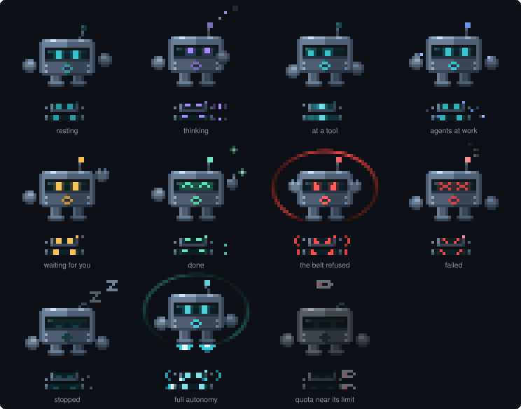

# Mo

**Mo** is Mode_Code's mascot: a small armored robot that keeps watch while Claude works. It sits at the left of the strip above the prompt in Claude Code and shows, at a glance and before you read a word, what Claude is doing and what just happened. It greets you on the first screen of the control center, and once more when the installation finishes.

Mo is a picture, never the only way something is said: every refusal, question and warning it shows also comes as words (the belt's message, Claude Code's own dialog, the strip, the footer lines). Turning Mo off changes nothing else.

## What each look means

| Look                                          | Mo is               | When                                                                                               |
| --------------------------------------------- | ------------------- | -------------------------------------------------------------------------------------------------- |
| dim eyes, a slow breath, a blink now and then | resting             | no turn runs                                                                                       |
| violet eyes looking up, three dots in turn    | thinking            | a turn runs and no tool is at work                                                                 |
| a light sweeping the visor, the hands tapping | at a tool           | a tool call of the main conversation runs                                                          |
| small blue drones circling                    | with agents at work | an agent (the Agent tool) runs                                                                     |
| white-hot eyes, jets, a cyan shield           | in full autonomy    | a [full-autonomy](autonomy.md) run is active                                                       |
| amber eyes, a raised hand                     | waiting for you     | the safety belt asks you, Claude asks a question (AskUserQuestion), a plan waits for your approval |
| mint eyes, a sparkle                          | done                | a turn just ended with an answer (for 4 seconds)                                                   |
| red stern eyes, a red shield                  | refusing            | the safety belt or a mode refused a call (for 4 seconds)                                           |
| red crossed eyes, a shake, a spark            | failed              | a turn just ended in an error (for 5 seconds)                                                      |
| eyes shut, a z rising                         | stopped             | a turn was stopped before it answered (for 6 seconds)                                              |
| dim, a battery with one red cell              | low on quota        | the quota reached its wrap-up level and nothing runs                                               |

When several hold at once, the first in this order wins: refusing, failed, waiting for you, the turn at work (full autonomy, agents, a tool, thinking), stopped, done, full autonomy between turns, low on quota, resting.

Claude Code's own permission question is not a separate look: the plugin learns when Claude Code asks, but not when you answer, so Mo shows the tool the question is about.

## Where Mo is drawn

- **The strip above the prompt.** A small Mo (two rows) beside a strip of two rows, only its face (one row) beside a strip that fits on one. Drawn by a surface module Claude Code runs on its own clock (`src/mod/mo-strip.ts`), so its frames cost the session nothing. Not on a phone, and not in a strip narrower than 72 columns, where the controls need the room.
- **The control center.** On the first screen, beside the Home category: the whole body where there is room, the small Mo where there is not, with a line that says what it shows (resting, a full-autonomy run, a quota near its limit, protection that needs a look).
- **The installer.** A still Mo beside "Installed.", in a terminal that draws colors.
- **This repository.** The README, this page and the social preview; drawn from the same pixels by `npm run mo-art`.

## Settings

| Setting                               | Effect                                                                                |
| ------------------------------------- | ------------------------------------------------------------------------------------- |
| `modules.mascot` (Settings › Modules) | off: no Mo anywhere                                                                   |
| `accessibility.reduceMotion`          | Mo stands still: each look is drawn at one moment, and what just happened still shows |
| `accessibility.plain`                 | no Mo (it is drawn in colored half blocks)                                            |

Mo's faint light (the shield, the sparkles) fades into the terminal's background: dark, or light when Claude Code's theme is a light one.

## How it is drawn

Every picture of Mo comes from `src/core/mo`: the body painted by hand as pixels (`art.ts`), the strip's marks drawn for their size (`marks.ts`), which look to show (`state.ts`), and the pixels as terminal cells, two stacked in one half block (`cells.ts`). Pure and deterministic, so the tests check every look at many moments, and that in the strip every look stays unlike every other.

Mo is an original character. It is not Anthropic's mascot and does not stand for Anthropic; see [TRADEMARK.md](../TRADEMARK.md).
